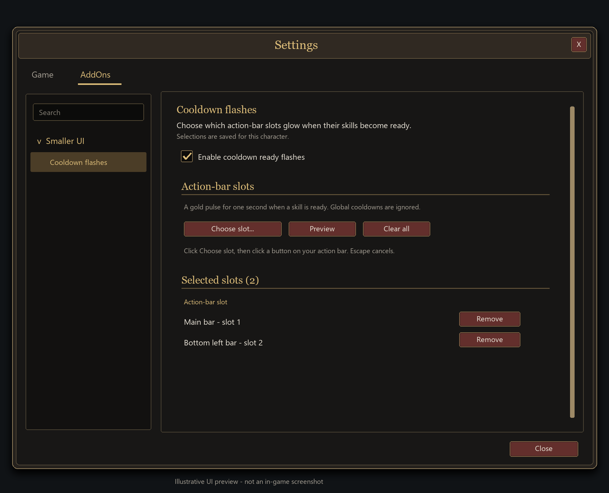

# Smaller UI

Finer UI scaling for **World of Warcraft: Forever**, with individual element sizes and optional cooldown-ready flashes.

Built because WoW's default UI scale slider doesn't go low enough for my setup.

## Install

1. [Download Smaller UI](downloads/SmallerUI-1.4.0.zip?raw=true).
2. Extract the `SmallerUI` folder into `_forever_/Interface/AddOns/` and enable it in game.
3. Open `/sui` or click the minimap gear to adjust your settings.

`/sui reset` restores the game's scale. Requires WoW Forever interface **16001**. No dependencies.

## Settings

*Illustrative UI previews, not in-game screenshots.*

