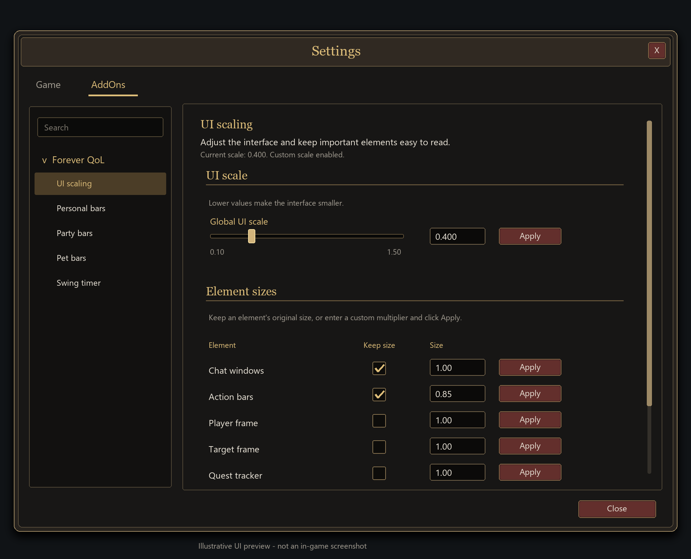
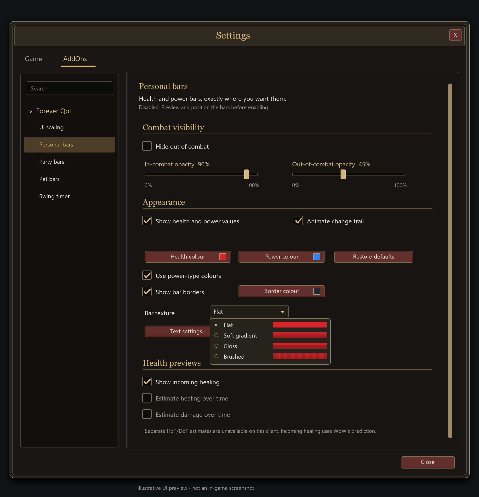
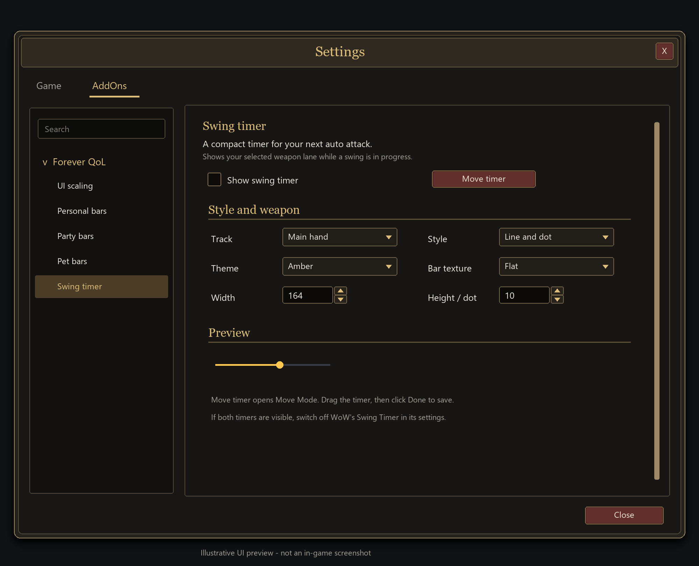

# Forever QoL

Finer UI scaling for **World of Warcraft: Forever**, with movable resource bars and a compact swing timer.

Built because WoW's default UI scale slider doesn't go low enough for my setup.

## Install

1. [Download Forever QoL 1.7.0](downloads/ForeverQoL-1.7.0.zip?raw=true).
2. Extract the `SmallerUI` folder into `_forever_/Interface/AddOns/` and enable it in game.
3. Open `/fqol` or click the minimap gear to adjust your settings.

The `SmallerUI` folder keeps existing settings. `/sui` still works, and `/fqol reset` restores the game's scale. Requires WoW Forever interface **16001**. No dependencies.

Enable **Swing timer** and choose a weapon lane, style, and theme. The timer starts with the first auto attack.

## Settings

In **Personal bars → Position and size**, choose **Curved HUD** for health on the left and your active resource on the right. Move both arcs together in **Move mode** and adjust their height, width, scale, and separation in Settings. **Horizontal bars** restores your stacked layout.

In **Personal bars**, **Party bars**, or **Pet bars**, open **Appearance** to preview class themes and mix their textures, trim, and colours. Choose **Fluid** motion for softer trails or **Vivid** for stronger feedback on damage, healing, and power spent. Health, power, and their numbers update immediately.

*Illustrative UI previews, not in-game screenshots.*

