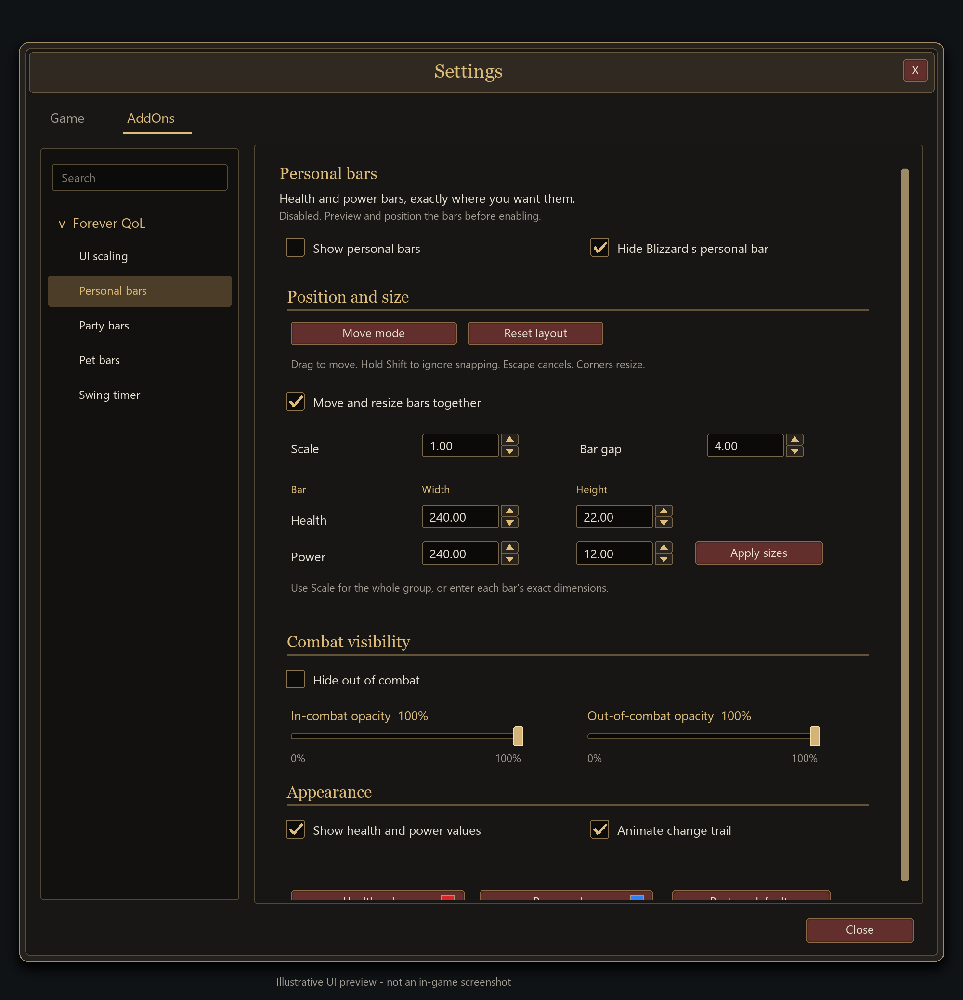
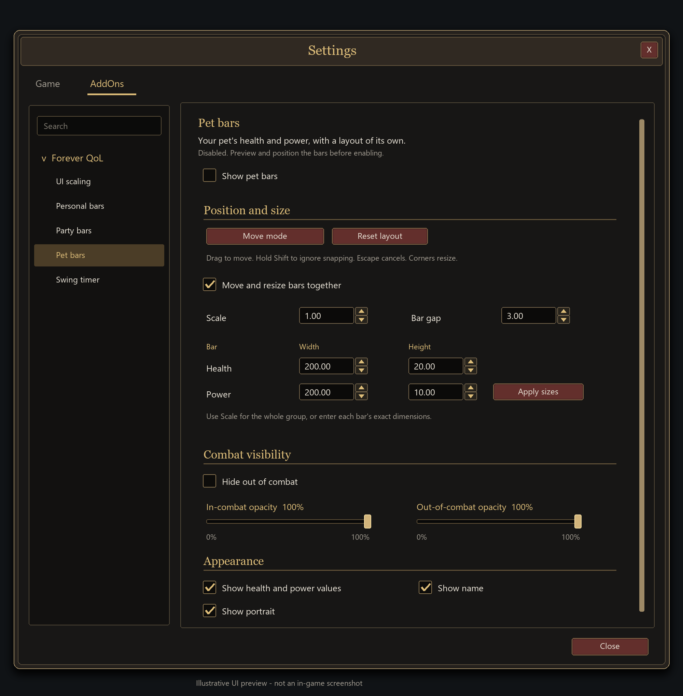
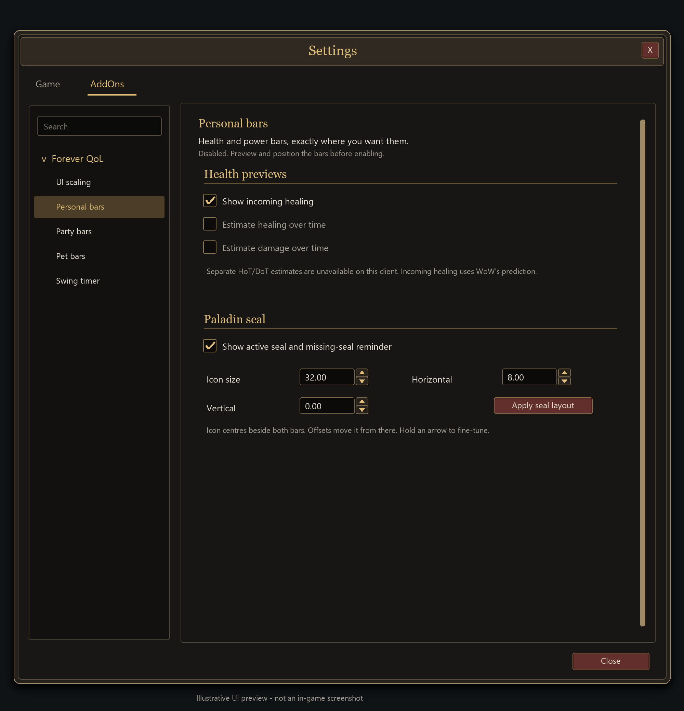
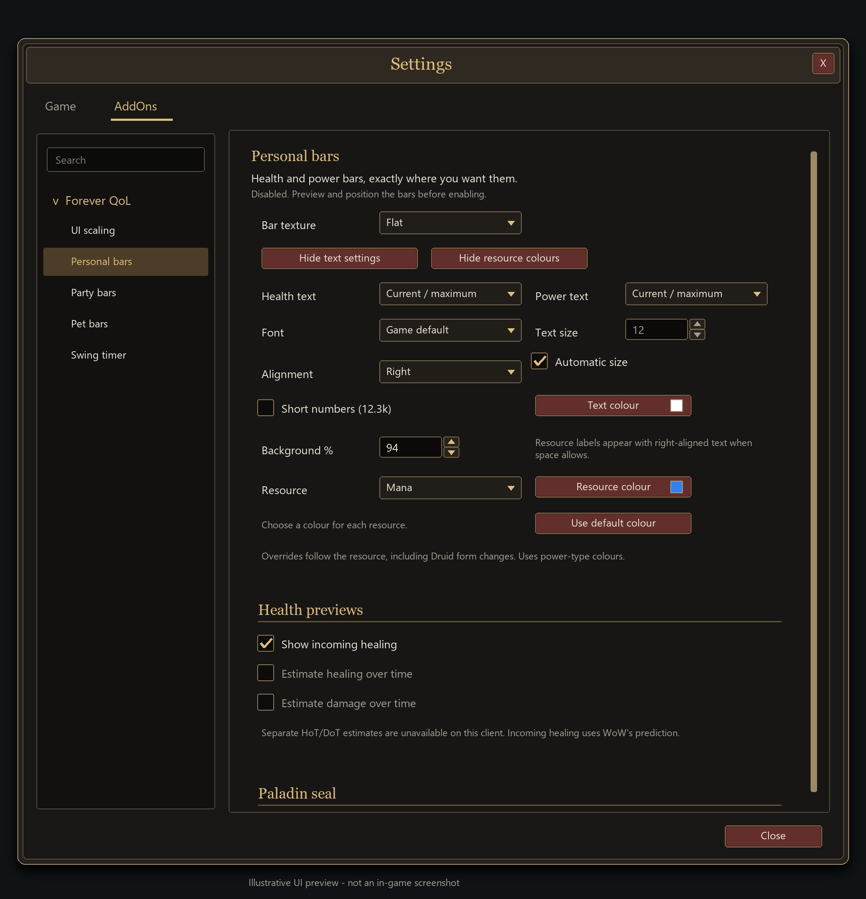
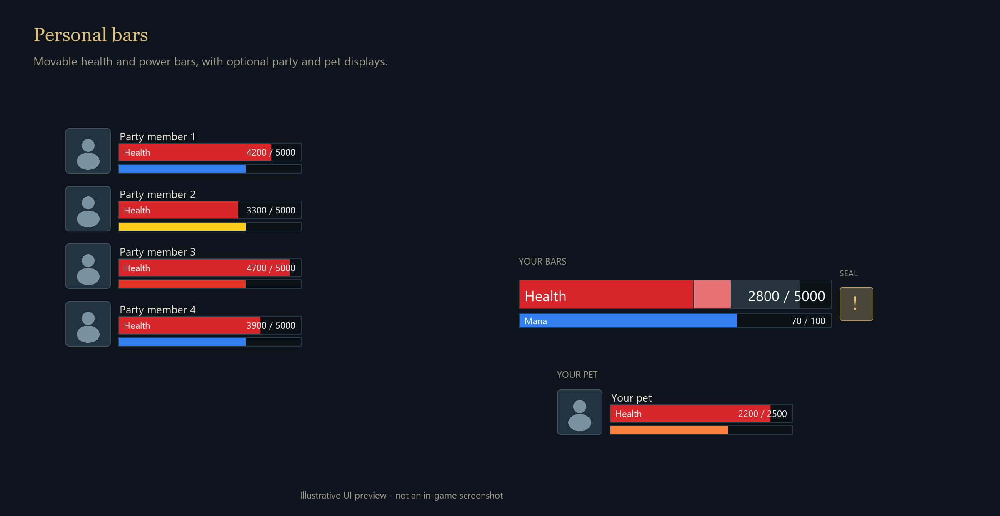
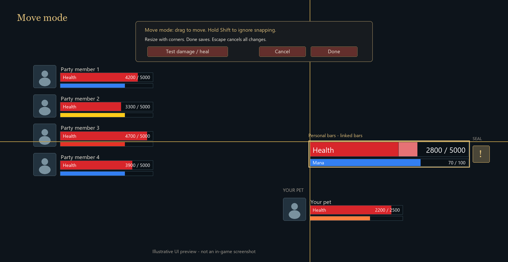

# Local resource-display build

Version: **1.5.0-local11**. This build has not been pushed to GitHub.

Seal fixes: the icon centres vertically beside both visible bars; its vertical
offset is now measured from that centre. Crusader/Fury seal families are included,
with localized names for higher ranks. A new cast is not overwritten by the old
aura snapshot, and overlapping seals prefer the most recently cast active one.
Test switching seals, letting the new seal expire, then dragging/reloading its icon.

Bar alignment: borders and fill insets now use one physical screen pixel, with
bar sizes rounded for rendering while preserving your saved dimensions. Linked
equal-width bars share both sides and stack from the rendered health-bar edge.
Borderless bars have no inset. Incoming-heal previews match the actual fill size.
After `/reload`, check both borders at your usual display scale, with and without
the border option. A zero bar gap should join the outer frames without a seam.

Compatibility fix: startup no longer attempts the restricted combat-log callback
registration. Separate HoT/DoT estimates are disabled when the client does not
offer a valid legacy frame event; native incoming-heal previews and immediate HP
remain available. An unexpected blocked action attributed to SmallerUI is recorded
in the character's `lastBlockedAction` diagnostic field without hiding WoW's warning.

1. Restart WoW and open `/sui`.
2. Choose **Personal bars**, then enable the display.
3. Use **Move mode**. Drag either bar; drag a corner grip to resize.
4. With **Move and resize bars together** enabled, the bars move together and
   resize proportionally. Switch it off to adjust each bar separately.
5. Click **Done** to keep the layout. **Cancel** or Escape restores the previous layout.

Selected elements get a named outline. Nearby edges and centres snap with gold
alignment guides; screen edges and centre also work. Hold **Shift** to ignore
snapping for precise placement. Snapping does not link displays permanently.
Combat cancels move mode and restores the layout. Test notes are in
[MOVE-MODE-DESIGN.md](MOVE-MODE-DESIGN.md).

Exact health/power widths, heights, scale and spacing are on the settings page.
Each dimension field has up/down arrows: click for one step, hold to repeat.
Arrows save that field immediately; typed values still use **Apply sizes**.
The **Smaller UI** group expands to select **UI scaling**, its first entry.
Personal bars, Party bars and Pet bars follow it.
**Test damage / heal** in edit mode previews the feedback without affecting your character.
Real health events immediately interrupt that demonstration and restore live values.

Current HP, power and numeric values update immediately from WoW's unit APIs on
their events. There is no easing or timer delay on the live fills. **Animate change
trail** affects only a dim historical trail, which can be turned off entirely.
Predicted healing remains separate from current HP. Equal-width linked health
and power bars share both horizontal edges, including at fractional scales.

Under **Appearance**, choose **Health colour** or **Power colour** using WoW's
native picker. Health defaults to red. **Use power-type colours** is enabled
by default, so Mana, Rage, Energy and Focus follow their usual colours. Choosing
a custom power colour switches that display to a fixed colour; tick the checkbox
to resume automatic colouring. **Restore defaults** restores red health and
automatic power colours. Personal, party and pet displays keep separate choices.
Incoming healing uses lighter shades of the selected health colour. Colour changes
apply immediately; Cancel restores the previous choice.

**Show bar borders** toggles the border around the bars, with a separate border
colour picker. **Text settings...** expands health/power formats (current, max,
percentage or combinations), automatic/manual font size, font, alignment, text
colour, short numbers and background opacity. These controls start collapsed.
Percentages use the current resource; predicted healing is never added to them.
Restricted values use native formatting, with exact-value fallbacks where needed.

**Resource colours...** expands a selector for Mana, Rage, Energy, Focus and any
other resources currently present. Choose a separate colour per resource or
restore just that resource. Overrides follow Druid forms and preserve other types.

Enable **Party bars** separately. Names, portraits and numeric values are optional.
Sample members appear during layout editing, so you can configure the display while solo.
Party bars are visual displays; your existing party controls remain available.

Enable **Pet bars** separately. It has its own position, scale, bar sizes,
and optional name, portrait and values. Use **Move mode** on that page
to arrange a sample pet even when none is summoned. The live display hides
when your pet is dismissed; pets without a power pool show health alone.

Power follows the active primary resource: warrior/bear Rage, rogue/cat Energy,
caster Mana, and pet Focus or Mana. Druid form changes update the range, label,
colour and values together. Secondary resources such as combo points are not
included in this build.

In-game checks: shift through Druid forms, spend/regenerate power, summon and
dismiss a pet, then move its bars and reload to check the saved layout.
Automated checks use simulated units; actual game rendering still needs testing.

**Personal bars → Health previews** controls lighter incoming-heal segments
and five-second HoT/DoT estimates on clients that allow combat-log frame events.
Unsupported controls are disabled with an explanation. Supported periodic estimates
need at least two observed ticks and disappear when required game data is hidden.
Incoming healing uses WoW's prediction values; instant heals may land too quickly
to show a cast preview.

**Personal bars → Paladin seal** toggles a seal icon beside your health/power bars.
Drag it separately in **Move mode**, or adjust size and horizontal/vertical
offsets. Missing seals show a grey last-used icon with `!`; unknown status shows `?`.
The icon appears only on Paladins with the personal display enabled.
Implementation and test details are in [RESOURCE-FEATURES.md](RESOURCE-FEATURES.md).

The custom personal display can temporarily hide Blizzard's personal resource bar.
Disabling it restores the previous setting; that change waits until combat ends.
Normal logout also restores the original setting. All layouts are saved per character.

